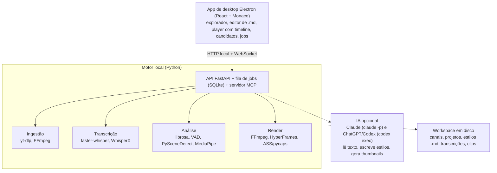

# Clipator — Requisitos e Arquitetura

Nov 1, 2026 · @Jordan Bragon

## Visão e princípios

O Clipator é um app local, open-source e gratuito que transforma um vídeo longo (link ou upload) em clips curtos ou médios, com o usuário escolhendo os cortes e o estilo. O único custo opcional é a IA (Claude ou Codex) usada pelo próprio usuário, e mesmo ela entra só onde as ferramentas locais não resolvem.

- **Local primeiro:** download, transcrição, análise de áudio, detecção de cenas e rostos, corte e renderização rodam na máquina do usuário.
- **IA só como juiz:** a IA recebe texto já resumido (trechos candidatos da transcrição), nunca o vídeo, e devolve JSON. Isso deixa cada análise em poucos milhares de tokens.
- **Funciona sem IA:** com a IA desligada, o app ainda sugere cortes pelas heurísticas locais.
- **Tudo é arquivo:** projetos, regras de estilo e resultados vivem em pastas e arquivos legíveis (.md, .json, .ass), versionáveis com git.
- **Humano no meio:** o usuário sempre aprova os cortes antes da renderização.

## Fluxo ponta a ponta

O pipeline tem oito etapas, e só a entrada e a seleção dependem do usuário; cada etapa grava seu resultado em arquivo, então dá para refazer só a etapa que mudou.

1. **Entrada:** o usuário cola um link (YouTube, Twitch, etc.) ou arrasta um arquivo para a pasta de um canal. Cria-se um projeto.
2. **Ingestão:** yt-dlp baixa o vídeo (e metadados como capítulos); FFmpeg extrai o áudio em WAV 16 kHz mono.
3. **Transcrição:** faster-whisper gera texto com timestamp por palavra; opcionalmente identifica quem fala (diarização).
4. **Sinais locais:** em paralelo, calcula energia do áudio, silêncios, velocidade de fala, cortes de cena e posição dos rostos.
5. **Candidatos:** heurísticas montam janelas entre a duração mínima e a máxima do canal (40 s a 3 min no padrão, o limite do YouTube Shorts) que começam e terminam em frase completa, e dão uma nota a cada uma, preferindo cortes perto da duração-alvo (90 s no padrão).
6. **Ranking por IA (opcional):** só o texto dos melhores candidatos vai para o Claude ou Codex, que devolve nota, título, gancho e ajuste fino de início e fim.
7. **Seleção pelo usuário:** lista de candidatos com nota, prévia e transcrição; o usuário marca os que quer, ajusta início e fim na timeline e escolhe formato (short 9:16, quadrado ou 16:9) e estilo. Para cada corte marcado, a IA sugere de 3 a 5 títulos sensacionalistas para escolher ou editar.
8. **Renderização:** FFmpeg corta, reenquadra seguindo o rosto, aplica zooms, legendas animadas, sons e marca d'água conforme o estilo .md; o usuário revisa a prévia e pode re-renderizar.

Tudo do passo 2 ao 5 e o 8 roda sem internet depois que o vídeo foi baixado.

## Ferramentas por etapa e stack recomendada

A stack recomendada é Python no motor de mídia (onde estão as melhores libs de áudio, vídeo e visão) e uma interface web em React servida localmente, com FFmpeg fazendo todo o trabalho pesado de vídeo.

| Etapa | Recomendado | Alternativa | Observação |
| --- | --- | --- | --- |
| Download por link | [yt-dlp](https://github.com/yt-dlp/yt-dlp) | upload direto | Para YouTube, exige um runtime JavaScript; o recomendado é Deno ([fonte](https://gigazine.net/gsc_news/en/20260525-yt-dlp-bun)) |
| Processamento de vídeo | FFmpeg / ffprobe | PyAV | Corte, crop, zoom, legendas (libass), mixagem e encode |
| Transcrição | [faster-whisper](https://modal.com/blog/choosing-whisper-variants) (large-v3-turbo) | whisper.cpp em Mac ou sem GPU | Roda em CPU com INT8; GPU acelera muito |
| Alinhamento e quem fala | [WhisperX](https://modal.com/blog/choosing-whisper-variants) + pyannote | só timestamps do faster-whisper | Diarização exige aceitar a licença do pyannote e token do Hugging Face |
| Silêncio e fala | Silero VAD | limiar de volume no FFmpeg (silencedetect) | Base para jump cuts e para cortar em pausas |
| Sinais de áudio | librosa | FFmpeg ebur128 | Volume, variação de tom, picos (risadas, gritos) |
| Cortes de cena | PySceneDetect | FFmpeg scene filter | Evita cortar no meio de uma transição |
| Rosto e reenquadramento | YuNet do OpenCV (detecção de rosto, modelo MIT) | MediaPipe, depois Haar do OpenCV | YuNet acha rosto pequeno de plano aberto, que o BlazeFace de curto alcance do MediaPipe perde; YOLOv8/Ultralytics é AGPL |
| Legendas animadas | ASS + libass via FFmpeg | [pycaps](https://pypi.org/project/pycaps-ai/) (MIT, estilo em CSS, usa Chromium) | ASS é rápido e sem navegador; pycaps para estilos mais ricos |
| Motion graphics e estilos | HyperFrames (Apache 2.0, HTML/CSS para MP4) | [Remotion](https://www.remotion.dev/docs/license/faq) | Remotion não é open source: grátis só até 3 pessoas, então fica fora do núcleo |
| IA (opcional) | `claude -p` com `--json-schema` ([docs](https://code.claude.com/docs/ja/headless)) | `codex exec --output-schema` ([docs](https://learn.chatgpt.com/docs/non-interactive-mode.md)) | Ambos usam o login salvo da CLI do usuário, ou chave de API |
| Backend local | FastAPI + fila de jobs simples (SQLite) | Celery/Redis | Um processo só, sem servidor externo |
| Interface | React + Monaco Editor | — | App de desktop em Electron desde o MVP, como o VS Code; o motor Python roda junto como processo auxiliar |
| Dados | Pastas + arquivos JSON/YAML/MD, índice SQLite | — | Workspace versionável com git |

O projeto [OpenShorts](https://github.com/mutonby/openshorts) (núcleo MIT) já combina faster-whisper, MediaPipe, YOLOv8, PySceneDetect e FFmpeg, e vale como referência de código; a diferença do Clipator é usar IA mínima, seleção humana e estilos em .md.

Sobre a IA: no Claude Code, o modo `--bare` pula o login OAuth e exige `ANTHROPIC_API_KEY`, então para usar a assinatura do usuário o Clipator chama `claude -p` sem `--bare`. No Codex, `codex exec` reaproveita o login salvo.

## Concorrentes open-source e o que aproveitar

Nenhum concorrente aberto junta IA mínima, seleção humana, estilos em .md criados pela IA do próprio usuário e workspace por canal em português; esse é o espaço do Clipator. Mesmo assim, cada um tem uma ideia boa para pegar.

| Projeto | Licença | Ponto forte | O que pegar para o Clipator |
| --- | --- | --- | --- |
| [OpenShorts](https://github.com/mutonby/openshorts) | MIT (núcleo) | Quatro modos de reenquadramento: seguir rosto, fundo desfocado, dois falantes, tela gravada | Os quatro layouts como opções de formato |
| [SupoClip](https://github.com/FujiwaraChoki/supoclip) | AGPL-3.0 | Título-gancho queimado nos primeiros segundos, templates de legenda, fontes próprias, servidor MCP e API REST, publicação direta | Título-gancho na abertura; um servidor MCP para o Claude Code controlar o Clipator; publicação na v2 |
| [AI-Youtube-Shorts-Generator](https://github.com/Anil-matcha/AI-Youtube-Shorts-Generator) | MIT | 5,6 mil estrelas; divide vídeos longos em blocos sobrepostos e funde destaques repetidos; exporta tudo em JSON | Blocos sobrepostos e remoção de duplicados para lives longas; uma CLI além da interface |
| [VideoHighlighter](https://github.com/Aseiel/VideoHighlighter) | AGPL-3.0 | Nota por cena, movimento, áudio, objetos e ações, 100% offline; linha do tempo de sinais; relatório explicando cada nota | Mostrar os sinais numa linha do tempo e o "por que essa nota" de cada candidato |
| [OpenMontage](https://www.dsebastien.net/openmontage/) | AGPL-3.0 | O agente de código (Claude Code e outros) vira o editor, guiado por pipelines YAML e skills em .md; controle de orçamento; cria variantes a partir de um vídeo de referência; checagem de qualidade antes e depois do render | Skills em .md, aprovação de gasto de IA, criar estilo a partir de vídeo de referência |
| [HyperFrames](https://themenonlab.blog/blog/heygen-hyperframes-video-as-code) (HeyGen) | Apache 2.0 | Vídeo escrito em HTML/CSS e renderizado em MP4, mesmo resultado sempre; skills prontas para Claude Code e Codex | Motor de motion graphics dos estilos (ver adiante) |
| [pycaps](https://pypi.org/project/pycaps-ai/) | MIT | Legendas estilizadas em CSS, marcação de palavras por regex | Já está na stack para legendas ricas |

O vídeo de referência que você mandou ([Léo Lamera, out/2026](https://www.youtube.com/watch?v=pS3TNsN7N3M)) mostra o mesmo caminho: o Claude faz transcrição, direção de arte, motion graphics, efeitos sonoros e trilha usando FFmpeg e Whisper, sem abrir o Premiere. O Clipator entrega a mesma ideia de graça, com estilos próprios.

Cuidado com licença: copiar código de projeto AGPL obriga o Clipator a ser AGPL. Ideias podem ser aproveitadas livremente.

**Reaproveitar código, não só ideias.** Os 8 repositórios foram clonados e lidos, e o arquivo `docs/referencias-concorrentes.md` do repo aponta, para cada módulo do Clipator, o arquivo exato que já resolve o problema e se dá para copiar. Regra para quem codificar: antes de escrever um módulo, abrir esses arquivos, rodar se possível e só então decidir entre copiar, adaptar ou reescrever. Os destaques:

- **OpenShorts (MIT):** reenquadramento seguindo o rosto (`reframe_v2.py`), quem está falando (`active_speaker.py`), tela dividida e webcam no canto, legendas ASS, posição do gancho fora do rosto, a IA devolvendo só uma lista de edições que vira filtro FFmpeg seguro (`edit_builder.py`) e um MCP completo em stdio e HTTP.
- **AI-Youtube-Shorts-Generator (MIT):** blocos sobrepostos e remoção de destaques repetidos para lives longas.
- **video-use (MIT):** pipeline de render a partir de lista de cortes, correção de cor automática e a transcrição compactada em frases que deixa a chamada de IA barata.
- **HyperFrames (Apache 2.0):** 239 componentes e 210 blocos prontos, incluindo 17 estilos de legenda animada.
- **SupoClip, VideoHighlighter e OpenMontage (AGPL):** como o Clipator é AGPL-3.0, o código deles também pode ser copiado, com atribuição.

## Detecção de pontos virais

A detecção é feita em duas camadas: heurísticas locais encontram e pontuam candidatos de graça, e a IA só reordena os 15 a 25 melhores, lendo texto e nunca vídeo.

**Camada 1, local e gratuita.** Cada janela candidata recebe uma nota de 0 a 100, soma ponderada dos sinais abaixo. Os pesos ficam no `regras.md` do canal, então um canal de podcast pode valorizar debate e um de games, reações.

| Sinal | Como medir localmente | Por que indica viral |
| --- | --- | --- |
| Gancho no início | Regex e listas de palavras nos primeiros 3 s: pergunta, número, "ninguém fala", "o segredo", negação forte | Segura quem está rolando o feed |
| Energia da voz | Volume e variação de tom (librosa) acima da média do vídeo | Emoção, ênfase, polêmica |
| Reações | Picos de volume sem fala transcrita, risadas | Momento engraçado ou surpreendente |
| Ritmo | Palavras por segundo e poucas pausas longas | Clip denso, sem enrolação |
| Troca de falantes | Muitas trocas por minuto (diarização) | Discussão, debate |
| História completa | Começa em início de frase e termina em pausa maior que 0,5 s | Clip se sustenta sozinho |
| Palavras-chave do canal | Termos do `canal.md` e TF-IDF da transcrição | Assunto que o público do canal procura |
| Sinais da plataforma | Capítulos e, se o yt-dlp expuser, o mapa de "mais repetidos" do YouTube | Mostra onde a audiência real voltou para assistir |

**Duração-alvo.** A nota de cada janela é multiplicada por um fator de duração que vale 1 na duração-alvo (`duracao_ideal` no `regras.md`, 90 s no padrão; vazio, 75% do caminho entre a mínima e a máxima) e cai até 30% na duração mínima, mas só 5% até a máxima. Sem isso, os sinais que são médias (energia, densidade de palavras-chave) favoreciam janelas curtas e o corte saía com a história pela metade. Desde outubro de 2024 o YouTube aceita Shorts de até 3 min; acima disso, o vídeo vira vídeo comum.

**Camada 2, IA opcional.** Uma única chamada recebe os candidatos (texto, duração, notas locais, os 30 s de fala antes e depois de cada um e o corpo do `regras.md`) e devolve JSON validado por schema: nota, título sugerido, frase de gancho, ajuste de início e fim em segundos e o motivo. O usuário escolhe um de três modos:

- **Sem IA:** só a camada 1. Custo zero.
- **Econômico (padrão):** IA só nos candidatos, cerca de 5 a 8 mil tokens de entrada por vídeo, independente da duração.
- **Completo:** a IA lê a transcrição inteira em blocos e pode achar momentos que as heurísticas perderam. Uma hora de fala dá em torno de 9 mil palavras.

Respostas da IA ficam em cache pelo hash da transcrição e das regras, então reabrir um projeto não gasta de novo. Os números de tokens são estimativas e serão medidos no protótipo.

## Blocos de edição feitos com código

Os efeitos abaixo são os blocos de montar que a IA do usuário combina para criar cada estilo; todos saem de FFmpeg, legendas ASS, pycaps ou HyperFrames e, depois de prontos, renderizam sem gastar IA.

| Efeito | Como fazer | Nível |
| --- | --- | --- |
| Legenda palavra a palavra (estilo karaokê) com a palavra atual colorida | ASS com tags `\k` a partir dos timestamps por palavra | MVP |
| Pop ou escala na palavra falada | ASS `\t(\fscx\fscy)` ou animação "pop" do pycaps | MVP |
| Destaque de palavras-chave e emojis | Lista ou regex do estilo marca palavras; pycaps aplica classe CSS | MVP |
| Reenquadramento 9:16 seguindo o rosto | Rosto (YuNet) a 8 amostras/s, câmera presa ao rosto por uma folga pequena e suavizada com filtro gaussiano de fase zero (sem atraso), `crop` exato sobre a fonte ampliada movido quadro a quadro por `sendcmd` (passos de 1 px da saída) | MVP |
| Dois falantes empilhados (split) | Dois crops que acompanham cada pessoa + `vstack` | MVP |
| Fundo desfocado para vídeo horizontal | `boxblur` do vídeo ampliado + vídeo original por cima (`overlay`) | MVP |
| Título/gancho fixo nos primeiros segundos | `drawtext` ou evento ASS com fade | MVP |
| Abertura com os ganchos do próprio corte em preto e branco, clarão branco e o corte inteiro em cor | Momentos escolhidos pela energia do áudio e pela fala (`abertura.py`), segunda passada sobre o clip pronto com `-ss` por gancho, `hue=s=0`, `eq` e `fade` branco + `concat` | v1 |
| Normalização de volume | `loudnorm` para cerca de -14 LUFS | MVP |
| Jump cuts (remove silêncios e "ééé") | Silero VAD + palavras de hesitação da transcrição + `concat` | v1 |
| Zoom de ênfase (punch-in) | `crop`/`scale` com expressão de tempo nos picos de energia | v1 |
| Zoom lento contínuo (Ken Burns) | `zoompan` | v1 |
| Barra de progresso | `drawbox` com largura proporcional ao tempo | v1 |
| Efeitos sonoros em cortes e zooms | `amix` com sons da pasta assets do canal | v1 |
| Música de fundo que abaixa quando falam | `sidechaincompress` | v1 |
| Logo ou marca d'água do canal | `overlay` com PNG | v1 |
| Sticker da marca enviado pelo usuário e sticker de texto sem fundo (o @ do canal) | PNG validado (até 5 MB, 32 a 4096 px) em `canais/<canal>/stickers/`; texto em APNG gerado com Pillow (`cta:texto`) com fonte (5 do Clipator, 70 do Google Fonts baixadas sob demanda e conferidas por sha256, e TTF/OTF do canal em `assets/fontes`), negrito, itálico, sublinhado, riscado, caixa alta, contorno e sombra + `overlay` que segura o último quadro | v1 |
| Transições entre trechos | `xfade` | v1 |
| Cor e look | LUT `.cube` com `lut3d`, `eq` | v1 |
| Tremida e glitch em momentos de impacto | `rgbashift`, `noise`, crop com deslocamento | v2 |
| Layout de tela gravada (screencast) | Tela em cima, rosto em baixo, com crops fixos | v2 |
| Templates animados complexos | HyperFrames, composição escrita pela IA | v2 |

A seção seguinte mostra como a IA do usuário junta esses blocos em estilos completos.

## Estilos criados pela IA do usuário

Todo estilo é escrito pelo Claude Code ou pelo Codex que o usuário já tem instalado, não por nós nem por um serviço de IA externo; o Clipator só fornece os blocos de edição, as instruções (skills) e o renderizador.

Um estilo é uma pasta:

```
estilos/dossie-investigativo/
  estilo.md          # descrição, parâmetros e regras para a IA
  composicao.html    # template HyperFrames escrito pela IA
  estilo.css
  preview.mp4        # amostra de 5 s gerada na criação
```

**Como um estilo nasce**

1. O usuário descreve o estilo em português ("legenda amarela grande, zoom em todo palavrão, som de whoosh") ou cola o link ou arquivo de um vídeo de referência.
2. Com referência, o Clipator extrai localmente um resumo: cortes por minuto, quadros-chave em baixa resolução, cores dominantes, posição e tamanho da legenda.
3. O Clipator chama `claude -p` ou `codex exec` com a skill "criar-estilo", que documenta todos os blocos disponíveis. A IA escreve a pasta do estilo.
4. O Clipator valida (lint do HyperFrames e do cabeçalho) e renderiza o preview de 5 s. O usuário aprova ou pede ajuste em linguagem natural, e a IA edita a pasta.

**Como um estilo é aplicado.** Cada estilo declara um de três níveis de IA por clip, e o usuário pode mudar na hora de renderizar:

| Nível | O que a IA faz | Custo por clip |
| --- | --- | --- |
| Fixo | Nada; o template recebe transcrição, título e sinais locais | 0 tokens |
| Assistido (padrão) | Lê o texto do clip e devolve JSON com palavras a destacar, momentos de zoom, emojis, efeitos sonoros e cartelas de números | estimativa de 1 a 2 mil tokens |
| Autoral | Escreve a composição HyperFrames inteira do clip, com motion graphics exclusivos, como no vídeo de referência | estimativa de 10 a 30 mil tokens |

A IA roda dentro da pasta do projeto com permissão para escrever só em `clips/<id>/`. O Clipator inclui as mesmas instruções como skill do Claude Code e como `AGENTS.md` para o Codex, então o estilo sai igual nos dois.

## Catálogo inicial de estilos

O usuário escolhe o estilo numa galeria com preview de cada um, filtrada por objetivo (gancho, legenda, números, abertura, transição). Os 12 abaixo são originais do Clipator, inspirados nos tipos de edição do vídeo de referência, sem copiar prompts de ninguém.

| Estilo | Como fica | Feito com | IA por clip |
| --- | --- | --- | --- |
| Podcast limpo | Legenda palavra a palavra embaixo, rosto centralizado, zoom leve na ênfase | FFmpeg + ASS | Fixo |
| Impacto | 1 a 3 palavras gigantes no centro, palavra-chave colorida, punch-in, whoosh e tremida | FFmpeg + ASS | Assistido |
| Texto grifado | Marca-texto animado passa sobre a frase-chave, tipografia editorial | HyperFrames | Assistido |
| Dossiê investigativo | Papel envelhecido, fotos recortadas, carimbos e texto datilografado no gancho | HyperFrames | Autoral |
| Recorte de revista | Palavras em recortes colados, estilo colagem | HyperFrames | Assistido |
| Números na tela | Contadores, barras e comparações animadas quando o falante cita números | HyperFrames | Assistido |
| Iceberg | Camadas descendo, com título por nível, para vídeos de curiosidades e teorias | HyperFrames | Autoral |
| Plantão urgente | Faixa de notícia, tarja "URGENTE", nome do convidado na tela | HyperFrames + ASS | Assistido |
| Reação dividida | Dois falantes empilhados, ou tela em cima e rosto embaixo | FFmpeg | Fixo |
| Gamer | Gameplay em cima, facecam embaixo, glitch e alertas nos picos de áudio | FFmpeg | Assistido |
| Documentário | Zoom lento, música, títulos de capítulo e fades | FFmpeg + HyperFrames | Assistido |
| Minimalista | Legenda discreta e cortes secos, sem efeitos | ASS | Fixo |
| Gancho em preto e branco | Abre com 4 a 8 s das falas mais fortes do corte sem cor, clarão branco e o corte inteiro; legenda de uma palavra amarela em itálico, palavras do assunto maiores | FFmpeg + ASS | Fixo |

Como são arquivos, o usuário também pode baixar estilos feitos pela comunidade e compartilhar os seus, o que dá conteúdo para o seu canal.

## O que fazem os grandes canais de cortes do Brasil

Nos quatro maiores canais de cortes analisados, quem traz views é o vídeo horizontal de 8 a 20 minutos, quase sem edição. O trabalho de verdade está na thumbnail e no título. Só o Flow usa os Shorts como canal principal, e nenhum dos quatro usa barra de progresso nem emoji na tela.

A análise foi feita em 01/11/2026 no seu PC. Foram listados os 15 Shorts e os 15 vídeos mais vistos entre os 60 mais recentes de cada canal, e baixadas 12 amostras para extrair quadros. O áudio não foi analisado. O relatório completo, com as listas de títulos, está em `C:\workspace\clipator-pesquisa\estilos-cortes.md`.

| Canal | Shorts: visual | Shorts: duração e views (medianas) | Vídeo horizontal | Thumbnail | Fórmula de título |
| --- | --- | --- | --- | --- | --- |
| Cortes do Flow | 9:16 em close, legenda sans itálica em 2 linhas a \~60% da altura, cor por quem fala (branco, amarelo, azul), punch-in a cada 3 a 6 s, figurinhas | 71 s, 399 mil | Multicâmera cru, sem legenda, logo no canto; 8 a 13 min | Rosto com careta e foto do assunto em moldura; texto preto em CAIXA ALTA com palavras em caixas amarelas; pergunta "SABE...?" | NOME + VERBO em caps + tema ("RENAN SANTOS ANALISA a FUGA de..."); nos Shorts, CAPS + emoji + 5 hashtags |
| Cortes do Inteligência (Vilela) | 9:16 em close, legenda amarela condensada em CAIXA ALTA no terço de baixo, logo fixo no canto; Shorts parados desde nov/2022 | 46 s, 78 mil | Vinheta de 2 s, faixa "DEIXE O LIKE" nos 10 s iniciais, tela final de 20 s; 10 a 20 min | Dois rostos e foto no meio; degradê roxo e azul neon; palavras em caixas magenta; frase terminando em "..." | Pergunta com palavras em caps + " - NOME DO CONVIDADO" |
| Cortes RedCast | 2024: uma palavra por vez em fonte de quadrinho com contorno grosso. 2026: três faixas (rosto, faixa vermelha com título, ilustração) e muito B-roll | 51 s, 29 mil | Grafismo de telejornal: "AO VIVO", manchete, ticker, prints de tweets; 12 a 26 min | 2 a 3 rostos em fundo vermelho, interjeição no canto ("É SÉRIO?"), palavras em amarelo, leetspeak ("VIOL3NCIA") | INTERJEIÇÃO! + MANCHETE EM CAPS ("PESADO! ... REVELA ...") |
| Cortes Podpah | 4:5 ou empilhado (foto da pessoa citada em cima, vídeo embaixo); legenda minúscula pequena, estilo nativo do TikTok | 45 s, 6 mil | Vinheta com mascote, tela final "ASSISTA TAMBÉM"; 12 a 20 min | Rosto e foto em moldura arredondada; borda amarela ou verde; citação do convidado; às vezes setas e emojis | Caixa mista com "?" ou "!", estilo notícia esportiva |

**O que isso muda no Clipator**

1. **Modo "corte longo" (16:9, 8 a 20 min):** acha um tema inteiro na transcrição e entrega com vinheta, marca d'água, faixa de inscrição e tela final, sem reenquadrar. Passa a ser tão importante quanto os Shorts.
2. **Gerador de thumbnail:** 3 ou 4 layouts (rosto com emoção, foto do assunto em moldura, frase-gancho de 3 a 4 linhas com palavras destacadas, cor do canal na borda). O quadro com a expressão mais forte sai da detecção de rosto, e a frase-gancho sai da mesma chamada de IA dos títulos.
3. **Quatro estilos novos no catálogo**, inspirados nesses canais e sem copiar marca:
   - **Podcast itálico:** legenda itálica em 2 linhas, cor por quem fala (precisa de diarização) e punch-in automático a cada 3 a 6 s.
   - **Amarelo condensado:** CAIXA ALTA amarela no terço de baixo e logo fixo no canto.
   - **Uma palavra:** uma palavra por vez, fonte de quadrinho com contorno grosso.
   - **Três faixas:** rosto em cima, faixa colorida com o título no meio e imagem do assunto embaixo.
4. **Mais layouts:** empilhado (foto em cima, vídeo embaixo), B-roll ou janela na metade de cima, e saída em 4:5.
5. **Modelos de título prontos no `titulos.md`:** "NOME + VERBO + tema", "Pergunta - NOME", "INTERJEIÇÃO! MANCHETE" e "minúsculas + emoji" para Shorts. Inclui um censor opcional em leetspeak para palavras que o YouTube restringe.

## Áudio de fundo: sons em alta e trilhas livres

Os sons em alta dos Shorts só são liberados quando adicionados dentro do app do YouTube, pelo botão "Adicionar som". Se o Clipator colocar a mesma música no arquivo, o vídeo leva uma reivindicação comum de Content ID. Em Shorts de 1 a 3 minutos, isso bloqueia o vídeo no mundo todo ([fonte](https://www.foximusic.com/blog/youtube-shorts-copyright-music-library-guide/)). Por isso o Clipator trabalha com dois caminhos.

| Caminho | Como funciona | Quando usar |
| --- | --- | --- |
| Som em alta, adicionado na postagem | O Clipator exporta o clip sem música, ou com a voz já equalizada para receber música por cima. A IA sugere de 1 a 3 sons em alta que combinam com o clima do corte, e o usuário adiciona pelo app do YouTube em volume baixo | Shorts até 60 s, onde a cobertura da biblioteca do YouTube vale |
| Trilha livre, já no arquivo | O Clipator mistura uma trilha da biblioteca local do canal, com ducking automático (a música abaixa quando alguém fala) e crédito na descrição quando a licença pede | Shorts acima de 60 s, cortes longos, TikTok e Reels |

**Como o Clipator sabe o que está em alta.** Não existe API oficial de sons em alta. O usuário cola a lista que vê no app em `sons-em-alta.md` (nome, artista, clima), e o Clipator lembra quando a lista está velha. Se o conector da vidIQ estiver ligado, ele ajuda a achar Shorts em alta do nicho para conferir os sons.

**Fontes de trilha livre para a biblioteca local**

| Fonte | Atribuição | Risco de Content ID | Observação |
| --- | --- | --- | --- |
| [Biblioteca de áudio do YouTube](https://www.socialpilot.co/youtube-marketing/youtube-audio-library) | Só nas faixas marcadas (filtro de atribuição) | Baixo no YouTube | Download manual no Studio, em MP3 de 320 kbps; também tem efeitos sonoros. Fora do YouTube, conferir faixa a faixa |
| [Pixabay Music](https://hellothematic.com/thematic-vs-pixabay/) | Não | Médio: o Pixabay não confere quem enviou, e uma faixa pode ser registrada depois | Bom acervo de phonk, lo-fi e suspense |
| Free Music Archive e Incompetech | Sim, Creative Commons BY | Baixo | Evitar faixas "NC" (não comercial) em canal monetizado |
| Freesound (filtro CC0) | Não | Baixo | Efeitos sonoros: whoosh, ding, impacto, risada |

Cada faixa entra em `assets/musicas/` com um `.yaml` ao lado: fonte, link, licença, texto de crédito, clima (suspense, tensão, épico, engraçado, chill, phonk) e BPM medido localmente com librosa. A IA escolhe o clima a partir do texto do clip. A escolha da faixa e o volume são locais. O estilo define o volume base (por exemplo, -22 dB) e se a música entra só nos 3 primeiros segundos, no fim ou no clip inteiro.

**Travas:** o Clipator não baixa música do YouTube nem de streaming. Ele avisa quando um Short passa de 60 s e está marcado para receber som em alta. E sugere publicar primeiro como "Não listado" para o Content ID checar o áudio antes do público ver.

## Títulos sensacionalistas

Ao marcar um corte, o Clipator mostra de 3 a 5 títulos sensacionalistas para ele; o escolhido vai para a cartela de abertura do clip, o nome do arquivo e o texto de postagem.

- **Sem custo extra:** os títulos saem na mesma chamada de ranking dos candidatos. O botão "gerar outros" faz uma chamada curta só daquele clip.
- **Fórmulas no `titulos.md` do canal:** por exemplo "NINGUÉM te conta isso sobre X", "Ele revelou X ao vivo", "O erro que custou R$ X", "Isso muda TUDO sobre X". Também define limite de caracteres, uso de CAIXA ALTA em 1 ou 2 palavras e emojis.
- **Sem IA:** as mesmas fórmulas são preenchidas com palavras-chave e números do trecho.
- **Base de referência embutida:** a pesquisa de 75 canais de cortes (`docs/pesquisa-titulos-e-thumbnails.md`) fica em `dados/base-virais/` e vale para todo canal, sem escolher nicho. O tema de cada vídeo é detectado pela transcrição; as fórmulas, palavras-gatilho, padrões de corte e de thumbnail e títulos reais do tema entram nos títulos e no prompt da IA. O que o canal define em `regras-e-textos/` vale por cima.
- **Uma trava, ligada por padrão:** o título pode exagerar a emoção, mas o que ele promete tem que acontecer no clip. YouTube e TikTok punem metadado enganoso, e clip que não entrega o título perde retenção.

## Multiagente: Claude e Codex juntos

O Clipator trabalha com os dois agentes ao mesmo tempo e dá a cada um a tarefa em que ele é melhor. O Claude cuida de texto e código. O Codex gera as imagens, porque ele tem geração de imagem embutida (`$imagegen`, com gpt-image-2) que funciona também em `codex exec`, sem chave de API ([fonte](https://codex.danielvaughan.com/2026/06/04/codex-cli-visual-workflows-image-input-gpt-image-2-generation-asset-pipelines-v0137/)).

| Tarefa | Agente padrão | Alternativa se faltar |
| --- | --- | --- |
| Ranquear cortes e sugerir títulos | Claude | Codex |
| Escrever e ajustar estilos (HyperFrames, .md) | Claude | Codex |
| Composição autoral de um clip | Claude | Codex |
| Frase-gancho e prompt da thumbnail | Claude | Codex |
| Gerar a imagem da thumbnail | Codex (`$imagegen`) | Nenhuma: só com o ChatGPT conectado |
| Revisão cruzada, opcional | Um revisa o resultado do outro | Desligada |
|  |  |  |

Quem faz o quê fica em `.clipator/agentes.yaml` e pode ser trocado por canal. Na abertura, o Clipator detecta quais CLIs estão instaladas e logadas e mostra o que está disponível. Algumas funções só aparecem quando o agente certo está conectado, como mostra a tabela abaixo.

**O que cada conexão libera.** A thumbnail feita a partir de imagem de referência é trabalho exclusivo do ChatGPT. Sem ele conectado, essa função fica bloqueada na interface, com um botão "Conectar ChatGPT" explicando o que ela libera.

| Função | Sem IA | Só Claude | Só ChatGPT/Codex | Os dois |
| --- | --- | --- | --- | --- |
| Baixar, transcrever, achar candidatos, cortar, renderizar estilos de nível Fixo | Sim | Sim | Sim | Sim |
| Ranking por IA, títulos sensacionalistas, frase-gancho | Fórmulas locais | Sim | Sim | Sim (Claude) |
| Criar e ajustar estilos, níveis Assistido e Autoral | Não | Sim | Sim | Sim (Claude) |
| Thumbnail por código (layout fixo, sem referência de imagem) | Sim | Sim | Sim | Sim |
| Thumbnail a partir de modelo ou imagem de referência | Não | Não | Sim | Sim (Claude escreve o prompt, ChatGPT gera) |
| Revisão cruzada entre agentes | Não | Não | Não | Sim |

A tela de Configurações mostra o status de cada conexão (instalado, logado, plano com geração de imagem) e o que falta para liberar cada função. A geração de imagem exige o ChatGPT Plus ou superior.

**Thumbnail a partir de um modelo**

1. O usuário coloca um ou mais modelos de thumbnail (imagens) em `canais/<canal>/thumbs/modelos/` e escreve o `thumb.md` do canal: cores, fonte, onde fica o rosto, regras do texto.
2. O Clipator escolhe localmente 3 quadros do clip com o rosto mais expressivo (pontos do rosto do MediaPipe: boca aberta, sobrancelhas levantadas).
3. O Claude escreve a frase-gancho (3 a 4 linhas, palavras destacadas) e o prompt final da thumbnail, juntando o `thumb.md`, o título escolhido e o modelo.
4. O Codex roda `codex exec -i modelo.png,quadro.png '$imagegen ...'` e gera de 2 a 4 variações em 1280x720.
5. O usuário escolhe uma. A imagem vai para `clips/<id>/thumb.png`, e o prompt fica salvo ao lado para refazer ou ajustar.

Três cuidados: a geração de imagem exige ChatGPT Plus ou superior, porque o plano grátis não tem; cada imagem gasta o limite do plano de 3 a 5 vezes mais rápido que texto; e falta confirmar no protótipo se a imagem passada com `-i` entra de fato como referência na geração. Se não entrar, o prompt descreve o modelo em texto.

## MCP local

O Clipator inclui um servidor MCP local, então o usuário pode fazer tudo pelo Claude Code, pelo Codex ou por qualquer cliente MCP, sem abrir a interface. Por exemplo: "clipa esse link no canal do podcast, estilo impacto, 5 cortes".

- **Como roda:** `clipator mcp`, via stdio, no mesmo motor Python, com o SDK oficial de MCP. Não abre porta na rede.
- **Ferramentas:** `listar_canais`, `criar_canal`, `criar_projeto`, `importar_video` (link ou arquivo), `status_job`, `ler_transcricao`, `corrigir_transcricao`, `listar_candidatos`, `selecionar_cortes`, `ajustar_corte`, `sugerir_titulos`, `listar_estilos`, `criar_estilo`, `renderizar`, `gerar_thumbnail`, `abrir_preview`.
- **Recursos para leitura:** `canal.md`, `regras.md`, estilos, transcrições e candidatos.
- **Limites:** só mexe dentro do workspace. Apagar qualquer coisa pede confirmação.
- **Registro automático:** o instalador roda `claude mcp add -s user clipator -- clipator mcp` e adiciona `[mcp_servers.clipator]` com `command = "clipator"` e `args = ["mcp"]` no `~/.codex/config.toml` ([formato](https://svelte.dev/docs/mcp/local-setup)).

Os próprios agentes internos do Clipator usam esse mesmo MCP em vez de editar arquivos soltos. Isso deixa o que a IA pode fazer bem delimitado e igual para Claude e Codex.

## Modo remoto (celular)

O usuário deixa o PC ligado com o Clipator aberto e acompanha pelo celular. Todo o processamento continua no PC; o celular só mostra a interface. O passo a passo para o usuário está em [modo-remoto.md](modo-remoto.md).

- **Como roda:** uma página web leve (HTML, CSS e JS sem build, em `motor/src/clipator/remoto_web/`) servida pelo próprio motor numa segunda porta (8766). Não é app de loja: abre no navegador e pode ser adicionada à tela inicial (manifest de PWA; o service worker só vale em HTTPS, como no `tailscale serve`).
- **De fora de casa:** pelo [Tailscale](https://tailscale.com) (grátis), que cria uma rede privada entre os aparelhos do usuário. Ninguém precisa mexer em NAT nem abrir porta no roteador. Em casa, também funciona pelo IP do Wi-Fi.
- **O que o celular faz:** vê o que está rodando (e cancela), escolhe o canal, cola um link novo para analisar, aprova cortes (com o estilo do canal ou outro) e assiste ou baixa o clip pronto.
- **Segurança:** desligado por padrão; liga em Configurações. A porta remota só atende IPs privados, do próprio PC e da faixa do Tailscale (100.64.0.0/10), então um redirecionamento de porta no roteador continua barrado. Cada celular entra uma vez lendo um QR code com código de uso único (vale 10 minutos, cai depois de 8 erros), que vira um cookie HttpOnly e SameSite=Strict; o motor guarda só o hash em `.clipator/remoto.json` e o usuário tira o acesso de cada aparelho no app. A API do celular (`/m/api`, em `api_remoto.py`) é separada da API do app e não lê nem grava arquivos, não mexe em configuração e não apaga nada. A API do app continua só em 127.0.0.1.

## Instalação com um comando

O Clipator é um app de desktop em Electron, instalado com dois cliques (.exe no Windows, .dmg no Mac, AppImage no Linux) e com atualização automática. Na primeira abertura, um assistente instala o que falta e registra o MCP. Para quem prefere terminal, a mesma instalação roda com uma linha:

```
# Windows (PowerShell)
irm https://raw.githubusercontent.com/<usuario>/clipator/main/install.ps1 | iex

# macOS e Linux
curl -fsSL https://raw.githubusercontent.com/<usuario>/clipator/main/install.sh | bash
```

O que o script faz, nesta ordem:

1. Detecta sistema, CPU, GPU (NVIDIA ou Apple Silicon) e espaço livre.
2. Instala o uv, que traz um Python 3.12 isolado, sem mexer no Python do sistema.
3. Instala o que faltar entre FFmpeg, Deno e Node.js LTS: winget no Windows, Homebrew no Mac, apt/dnf no Linux.
4. Instala o Clipator com `uv tool install clipator`.
5. Baixa o modelo de transcrição adequado ao hardware: menor para quem só tem CPU, large-v3-turbo para quem tem GPU.
6. Procura Claude Code e Codex. Se faltar algum, oferece instalar pelo instalador oficial e fazer o login. Depois registra o MCP nos dois.
7. Cria um workspace de exemplo, com um canal, os estilos do catálogo e um vídeo curto de teste.
8. Abre o app e o fixa no menu Iniciar ou no Dock.

O comando `clipator doctor` confere tudo e diz o que falta, e `clipator uninstall` remove o app sem apagar o workspace.

**Por que Electron, e não página no navegador ou Tauri:** é a base do VS Code, então o Monaco e o visual de IDE saem naturalmente; o Chromium embutido toca vídeo do mesmo jeito em Windows, Mac e Linux (o Tauri usa o navegador do sistema, que muda de um para outro); e o Node embutido é o mesmo que HyperFrames, Claude Code e Codex usam. O custo é um instalador uns 150 MB maior, pouco perto do modelo de transcrição. O motor Python continua separado, empacotado junto e falando com a interface por HTTP local.

**Tutorial curto para o usuário** (vale também como roteiro do seu vídeo):

1. Baixe o instalador do Clipator na página de releases do GitHub e dê dois cliques.
2. Responda "sim" quando ele oferecer instalar e logar o Claude Code ou o Codex.
3. Espere o assistente de primeira abertura terminar. Na primeira vez leva alguns minutos por causa do download do modelo de transcrição.
4. Crie a pasta do seu canal, cole o link de um vídeo e clique em Analisar.
5. Marque os cortes, escolha título e estilo e clique em Renderizar. Os clips aparecem na pasta `clips/` do projeto.

## Skills do usuário integradas ao Clipator

Das 17 skills em `SKILLS/` do repo, 9 viram partes do produto, 4 servem para construir o próprio Clipator e 4 ficam fora do escopo. Duas têm licença que impede distribuir num repo aberto, e isso precisa ser resolvido antes do primeiro commit público.

| Skill | Onde entra no Clipator | Como |
| --- | --- | --- |
| `rank-de-ideia` | Ranking de cortes | A régua de 0 a 10 (pool de atenção 0 a 4, prova visível 0 a 2, conexão 0 a 2, fit de título 0 a 1, outlier 0 a 1) vira a rubrica que a IA usa na camada 2, calibrada pelo `canal.md` |
| `titulo-4-palavras` | Títulos | Calibração com os 5 títulos que mais performaram e os 5 que floparam no canal; os 4 padrões de partida entram no `titulos.md` ao lado das fórmulas sensacionalistas |
| `gerador-de-hooks` | Cartela de abertura e frase-gancho | 6 variações de 2 linhas com até 40 caracteres, nos 6 ângulos (número, contrário, transformação, autoridade, confissão, futuro) |
| `briefing-thumbnail` | Thumbnail | Calibração (CTR, 3 thumbs boas e 3 ruins), composição de referência no `thumb.md` e a regra de ouro: nunca regenerar o rosto, sempre compor sobre o quadro real. Essa regra vira obrigatória no prompt enviado ao ChatGPT |
| `receita-viral` | "Repetir o que deu certo" | O usuário aponta um clip que performou acima da média; a IA extrai a receita (gancho, duração, estilo, título) e grava como regra ou estilo do canal, com o aviso de espelhar sem copiar |
| `score-de-post` | Nota final antes de exportar | Os 5 critérios (hook, voz, densidade, estrutura, prontidão) adaptados para clip, com 3 correções priorizadas |
| `humanizador` | Descrição e texto de postagem | Passa a descrição gerada pela IA pelo checklist antes de mostrar ao usuário |
| `video-use` (MIT) | Motor de corte | Boas práticas técnicas: cortar no keyframe com stream copy quando der, normalizar antes de concatenar, preview em baixa resolução, nunca sobrescrever o original |
| `vidiq-youtube-data` | Calibração do canal, opcional | Conector MCP da vidIQ para outliers, títulos de alto CTR e métricas, quando o usuário tiver conta. Sem ele, a calibração usa yt-dlp e o que o usuário colar |
| `awesome-design-md`, `refero-styles` | Desenvolvimento da interface | Escolher um DESIGN.md (ex.: estilo de editor como Linear ou Cursor) para a UI do Clipator ficar consistente entre Claude e Codex |
| `svg-diagram`, `marp-slides` | Documentação | Diagramas do repo e slides para o seu vídeo de lançamento |
| `remotion` | Fora do núcleo | O Remotion não é open source (grátis só até 3 pessoas), então o motor segue sendo o HyperFrames |
| `aprendizado-criacao-conteudo` | Base de raciocínio dos agentes, opcional | Os 24 frameworks dão contexto ao ranking e aos títulos, mas a licença é "Proprietary". Fica fora do repo; o usuário que tiver a skill aponta o caminho nas configurações |
| `roteiro-teleprompter`, `area-de-membros` | Fora do escopo | São para criar vídeos e monetizar, não para clipar. Podem virar módulos futuros |

**Licenças.** `aprendizado-criacao-conteudo` foi baixada gratuitamente do fornecedor, e `remotion` e `marp-slides` não declaram licença. Por decisão do Jordan, a pasta `SKILLS/` é versionada como está no repo público. O Clipator também lê skills de uma pasta configurável.

### Skills próprias e skills pagas

O usuário pode subir as próprias skills e também comprar ou vender skills de outros criadores. O Clipator continua grátis e não cobra nada nem processa pagamento: a venda acontece direto entre quem cria e quem compra.

**Minhas skills (MVP).** Na aba Skills do app, o usuário importa uma skill por pasta, arquivo .zip ou link do GitHub. Cada skill é uma pasta com `SKILL.md` e um `clipator-skill.yaml` contendo:

- nome, autor, versão e licença;
- preço: grátis ou pago, com o link de compra;
- o que a skill faz: estilo, regras de título, thumbnail ou etapa do fluxo.

O app valida o pacote, mostra o que a skill altera antes de ativar e permite escolher onde ela vale: global, canal ou projeto. As skills ficam em `~/.clipator/skills/` e nunca vão para o repo do Clipator. O usuário também pode exportar uma skill própria como .zip para vender ou compartilhar.

**Loja de skills (v1).** É uma vitrine dentro do app, alimentada por um índice público num repositório do GitHub. Os criadores entram com um pull request, e o Clipator não precisa de servidor próprio.

- **Skill grátis:** um clique instala.
- **Skill paga:** o botão leva à página de compra do criador (Hotmart, Kiwify, Gumroad ou outra). Depois da compra, o usuário importa o .zip que recebeu, ou cola uma chave de licença que o app confere com o serviço do criador.
- **Avisos:** o índice mostra autor, licença e avaliações, e o app avisa que skills de terceiros não são revisadas pelo projeto.

**Pontos que mudam requisitos:** a rubrica do ranking deixa de ser genérica e passa a ser calibrada por canal na criação do canal (top 5 e flop 5 de vídeos e títulos); a thumbnail com IA passa a exigir quadro real do rosto; e entra uma etapa de "nota final" antes de exportar.

## Customização por arquivos .md

Cada regra de estilo é um arquivo .md com duas partes: um cabeçalho YAML que o motor aplica direto, sem IA, e um corpo em texto livre que só vai para a IA quando ela está ligada.

Três tipos de arquivo, todos editáveis no workspace:

- **`canal.md`:** identidade do canal (público, tom, idioma, assuntos, palavras-chave, o que evitar).
- **`regras.md`:** como escolher cortes (duração, pesos das heurísticas, temas proibidos, quantos clips por vídeo).
- **`estilos/*.md`:** como o clip fica (formato, legenda, zoom, sons, logo).

As regras se sobrepõem em cascata, da mais geral para a mais específica: global do workspace, depois canal, depois projeto, depois o clip. Assim um ajuste num clip não muda o estilo do canal.

Exemplo de `estilos/shorts-impacto.md`:

```markdown
---
formato: 9:16
resolucao: 1080x1920
reenquadramento: seguir-rosto
legenda:
  modo: palavra-a-palavra
  fonte: Montserrat ExtraBold
  tamanho: 80
  cor: "#FFFFFF"
  destaque: "#FFE600"
  posicao: centro-baixo
  animacao: pop
  max_palavras_por_linha: 3
zoom:
  enfase: true
  intensidade: 1.15
jump_cuts: true
sons:
  zoom: assets/sfx/whoosh.wav
musica:
  arquivo: assets/musicas/lofi.mp3
  volume: -22dB
logo: assets/logo.png
---

Tom energético. Destaque em amarelo números, valores em reais
e palavras de choque. Título do clip com no máximo 6 palavras,
sem clickbait mentiroso.
```

O motor valida o cabeçalho contra um schema e mostra erros no editor, como uma IDE. O corpo do .md entra no prompt da IA para gerar títulos, escolher palavras a destacar e julgar cortes.

## Workspace estilo IDE

O workspace é uma pasta comum no disco, com uma subpasta por canal e uma por projeto dentro dele; a interface só mostra e edita essa árvore.

```
meu-workspace/
  .clipator/config.yaml        # IA escolhida, modelo Whisper, GPU
  estilos/                     # estilos globais, valem para todos os canais
  canais/
    podcast-do-jordan/
      canal.md
      regras-e-textos/         # o que o usuário edita: LEIA-ME, regras, títulos, thumb, referências
        regras.md
        titulos.md
      estilos/shorts-impacto.md
      assets/                  # logo, fontes, músicas, efeitos sonoros
      projetos/
        2026-11-01-ep12-convidado/
          projeto.yaml         # origem, status de cada etapa
          fonte/video.mp4
          analise/
            transcricao.json
            sinais.json
            candidatos.json
          clips/
            01-o-segredo/
              clip.yaml        # início, fim, formato, estilo, ajustes
              legenda.ass
              saida.mp4
```

Layout da tela, no modelo de um VS Code:

- **Esquerda, explorador:** árvore de canais, projetos, estilos e assets, com criar, renomear e arrastar vídeos.
- **Centro, editor em abas:** Monaco para .md e .yaml (com validação); para um projeto, player com timeline, forma de onda e marcações dos candidatos.
- **Direita, candidatos:** lista com nota, título, duração e caixa de seleção; botão "Renderizar selecionados" com formato e estilo.
- **Embaixo, painel de jobs:** progresso e logs de download, transcrição e render, como o terminal de uma IDE.

Como tudo é arquivo, o usuário pode versionar o workspace com git, sincronizar por Drive e compartilhar estilos entre canais copiando um .md.

## Arquitetura e requisitos

O Clipator é um único processo local: a interface conversa com um motor Python que enfileira jobs e grava tudo no workspace; a IA é um adaptador plugável que só recebe texto.



Os quatro workers são independentes e retomáveis: se a transcrição já existe no disco, a análise roda direto. O adaptador de IA tem uma interface única (`ranquear(candidatos, regras) -> JSON`), então dá para trocar Claude, Codex ou um modelo local no futuro.

**Requisitos funcionais do MVP**

1. Criar workspace, canais e projetos como pastas; editar .md e .yaml com validação.
2. Importar vídeo de até 4 horas por link do YouTube ou da Twitch (yt-dlp) ou por upload, em português ou inglês.
3. Transcrever com timestamp por palavra e permitir corrigir o texto; rodar em CPU com aviso de tempo, e usar GPU quando houver.
4. Gerar e pontuar candidatos com heurísticas locais; ranking por IA opcional nos três modos.
5. Mostrar candidatos com prévia, nota, motivo e transcrição; selecionar e ajustar início e fim. A duração máxima dos Shorts vem das regras do canal (padrão 3 min, o limite do YouTube; antes era 60 s).
6. Renderizar em 9:16, 1:1, 4:5 ou 16:9, em lote, com os 16 estilos do MVP, incluindo o corte longo 16:9 de 8 a 20 min. A cartela de título nos 3 s iniciais é ligada ou desligada pelo usuário em cada clip.
7. Editor manual completo: cortes internos, mover legenda, zooms e efeitos à mão.
8. Mostrar progresso e logs de cada job; permitir cancelar e refazer etapas.
9. Sugerir de 3 a 5 títulos sensacionalistas por corte selecionado, com fórmulas do canal; trava do título ligada por padrão e censor leetspeak opcional por canal.
10. Criar e ajustar estilos pela IA do usuário a partir de descrição ou vídeo de referência, com preview; galeria de estilos por objetivo.
11. Gerar thumbnail por código para todos, e por IA com imagem de referência quando o ChatGPT estiver conectado.
12. Exportar MP4, thumb e texto de postagem (sem publicação direta no MVP).
13. Interface em português e inglês, com troca nas configurações; tema claro e tema escuro (o padrão segue o sistema operacional, e o editor Monaco e as prévias acompanham o tema); aviso de direitos autorais no primeiro uso.
14. Importar, ativar e exportar skills próprias (pasta, .zip ou GitHub), com escopo global, canal ou projeto; loja com skills grátis e pagas na v1.

**Requisitos não funcionais**

- Gratuito e open-source, sem conta nem servidor do Clipator.
- Funciona sem IA e offline depois do download do vídeo.
- Roda em CPU; GPU NVIDIA ou Apple Silicon só acelera.
- Nenhum vídeo ou áudio sai da máquina; a IA só recebe texto e, na criação de estilo, alguns quadros em baixa resolução.
- Resultado reproduzível: mesmo vídeo + mesmos .md = mesmo clip.
- Instalação em um comando ou instalador, com FFmpeg, Deno e o necessário para o HyperFrames (Node.js e Chromium) incluídos.

## Decisões fechadas

Todas as perguntas em aberto foram respondidas por Jordan em 01/11/2026. Estas decisões valem para o MVP.

| # | Tema | Decisão |
| --- | --- | --- |
| 1 | Sistemas | Windows, Mac e Linux ao mesmo tempo no MVP |
| 2 | Hardware | Roda em CPU (Whisper menor + aviso de tempo); GPU só acelera |
| 3 | Idiomas dos vídeos | Português e inglês |
| 4 | Idioma da interface | Português e inglês, com troca nas configurações |
| 5 | Acesso à IA | CLI com assinatura primeiro; chave de API opcional |
| 6 | Links aceitos | YouTube e Twitch (upload sempre disponível) |
| 7 | Duração máxima do vídeo | Até 4 horas |
| 8 | Formatos | 9:16, 1:1, 4:5 e 16:9 |
| 9 | Publicação | Só exporta no MVP (MP4, thumb, texto de postagem); publicação direta na v1 |
| 10 | Edição manual | Editor completo no MVP: cortes internos, mover legenda, zooms e efeitos à mão |
| 11 | Direitos autorais | Aviso no primeiro uso |
| 12 | Estilos do MVP | Todos os 16 (12 do catálogo + 4 dos canais de cortes) |
| 13 | Nível de IA padrão por clip | Assistido |
| 14 | Trava do título | Ligada por padrão, desligável por canal |
| 15 | Cartela de título nos 3 s iniciais | O usuário decide por clip na hora de renderizar; o estilo só sugere |
| 16 | Censor leetspeak | Desligado; liga por canal |
| 17 | Corte longo 16:9 (8 a 20 min) | No MVP |
| 18 | Gerador de thumbnail | No MVP: por código para todos, e por IA quando o ChatGPT está conectado |
| 19 | Thumb com imagem de referência | Só com ChatGPT conectado (Plus ou superior) |
| 20 | Revisão cruzada entre IAs | Desligada; o usuário liga por canal ou por clip |
| 21 | Trilhas e efeitos sonoros | Download opcional oferecido pelo assistente na primeira abertura |
| 22 | Duração máxima dos Shorts | Cada canal define nas regras (padrão 3 min, o limite do YouTube Shorts; era 60 s até 15/11/2026) |
| 23 | Distribuição | GitHub Releases (instaladores) + PyPI (motor, CLI e MCP) |
| 24 | Pasta SKILLS/ | Versionada como está no repo público, por decisão do Jordan |
| 25 | Modo remoto (celular) | Página web servida pelo motor, acesso de fora pelo Tailscale (sem abrir portas), pareamento por QR code; desligado por padrão (20/11/2026) |

## Fontes

- [yt-dlp e runtime JavaScript (Gigazine, mai/2026)](https://gigazine.net/gsc_news/en/20260525-yt-dlp-bun)
- [Variantes do Whisper (Modal)](https://modal.com/blog/choosing-whisper-variants)
- [OpenShorts no GitHub](https://github.com/mutonby/openshorts)
- [pycaps no PyPI](https://pypi.org/project/pycaps-ai/)
- [Licença do Remotion, FAQ](https://www.remotion.dev/docs/license/faq)
- [Remotion vs Motion Canvas vs Revideo (PkgPulse)](https://www.pkgpulse.com/guides/remotion-vs-motion-canvas-vs-revideo-programmatic-video-2026)
- [Claude Code em modo não interativo](https://code.claude.com/docs/ja/headless)
- [Codex em modo não interativo](https://learn.chatgpt.com/docs/non-interactive-mode.md)

* [SupoClip no GitHub](https://github.com/FujiwaraChoki/supoclip)
* [AI-Youtube-Shorts-Generator no GitHub](https://github.com/Anil-matcha/AI-Youtube-Shorts-Generator)
* [VideoHighlighter no GitHub](https://github.com/Aseiel/VideoHighlighter)
* [OpenMontage (resenha de Sébastien Dubois)](https://www.dsebastien.net/openmontage/)
* [HyperFrames (The Menon Lab, set/2026)](https://themenonlab.blog/blog/heygen-hyperframes-video-as-code)
* [Alternativas abertas ao OpusClip (OpenApps)](https://openapps.pro/alternatives/opusclip)
* [Vídeo de referência de Léo Lamera](https://www.youtube.com/watch?v=pS3TNsN7N3M)

- [Geração de imagem no Codex CLI (Daniel Vaughan, jun/2026)](https://codex.danielvaughan.com/2026/06/04/codex-cli-visual-workflows-image-input-gpt-image-2-generation-asset-pipelines-v0137/)
- [Configurar MCP local no Claude Code e no Codex (Svelte docs)](https://svelte.dev/docs/mcp/local-setup)

* [Música em YouTube Shorts e direitos autorais (Foxi Music, 2026)](https://www.foximusic.com/blog/youtube-shorts-copyright-music-library-guide/)
* [Biblioteca de áudio do YouTube (SocialPilot)](https://www.socialpilot.co/youtube-marketing/youtube-audio-library)
* [Pixabay e risco de Content ID (Thematic)](https://hellothematic.com/thematic-vs-pixabay/)
